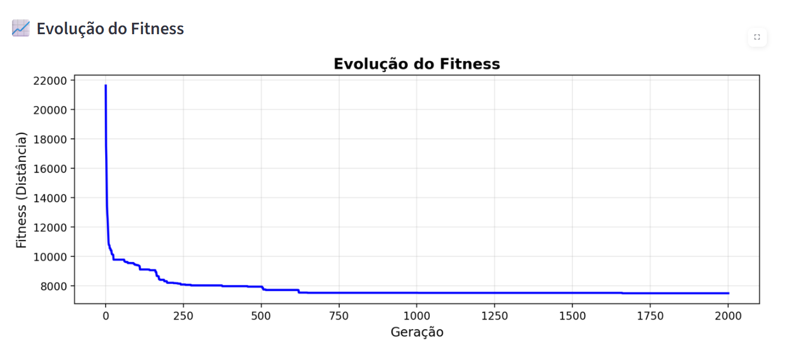
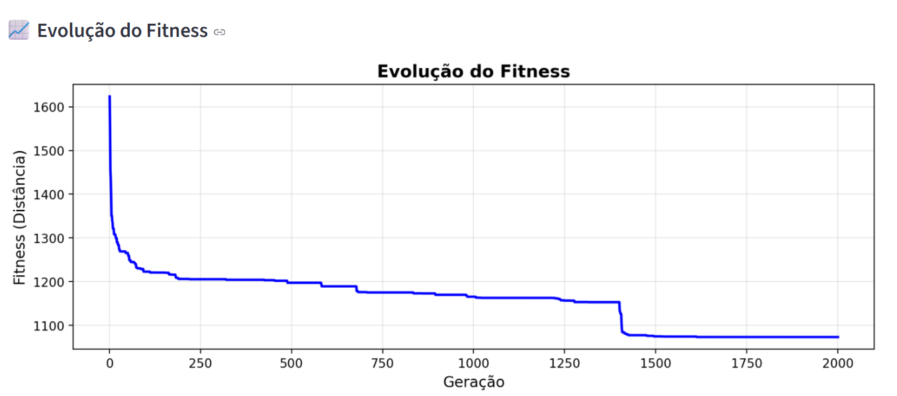

# 🚑 Medical Route TSP Optimizer - FIAP Tech Challenge Fase 2 Grupo 

Sistema avançado de otimização de rotas médicas usando Algoritmos Genéticos com restrições realistas e integração com LLM para geração de relatórios inteligentes.

## 👥 Equipe - FIAP Tech Challenge

- **Bruno Amorim**: RM365279
- **Gabriel Rizzo**: RM366033
- **Mauricio Magnani**: RM365929
- **Vinicius Martins**: RM365278
- **Gerson Luiz**: RM366284
  
## 📋 Índice

- [Visão Geral](#-visão-geral)
- [Funcionalidades](#-funcionalidades)
- [Arquitetura](#-arquitetura)
- [Instalação](#-instalação)
- [Uso](#-uso)
- [Restrições Implementadas](#-restrições-implementadas)
- [Datasets](#-datasets)
- [Configuração](#-configuração)
- [Testes](#-testes)
- [Equipe](#-equipe)

## 🎯 Visão Geral

Este projeto implementa um sistema completo de otimização de rotas para veículos médicos (ambulâncias) usando Algoritmos Genéticos avançados. O sistema considera múltiplas restrições do mundo real e oferece visualização em tempo real do processo de otimização.

### ✅ Status do Projeto - COMPLETO

- **Algoritmo Genético**: Sistema completo com operadores especializados
- **5 Restrições Médicas**: Sistema modular para constraints realistas  
- **Integração LLM**: Sistema completo de IA para instruções e relatórios
- **Implementam 2 problemas**: Problema do ATT48 e hospitais de SP, ambos aplicando restrições.
- **Visualização**: Interface Streamlit com mapa real (Problema dos hospitais de SP)
- **Documentação**: README detalhado + documentação inline
- **Testes**: Suite automatizada de validação

## ✨ Funcionalidades

### Core do Algoritmo Genético
- **População adaptativa**: Controlado via medical_tsp_config.json
- **Operadores genéticos**: Crossover ordenado, mutação adaptativa
- **Seleção inteligente**: Torneio e rank-based com awareness de diversidade
- **Fases de execução**: Exploração inicial + Refinamento posterior
- **Elitismo**: Preservação das melhores soluções

### Visualização e Interface
- **Interface Streamlit**: Dashboard web interativo com mapas
- **Suporte a mapa real**: Integração com dados de hospitais de São Paulo
- **Gráficos de evolução**: Acompanhamento do fitness ao longo das gerações

## 🏗 Arquitetura

```
medical-tsp-fiap/
├── core/                           # Núcleo do algoritmo genético
│   ├── enhanced_genetic_algorithm.py
│   ├── restriction_manager.py
│   ├── config_manager.py
│   └── base_restriction.py
├── restrictions/                   # Restrições implementadas
│   ├── vehicle_capacity_restriction.py  # Capacidade de pacientes
│   ├── multiple_vehicles.py       # Múltiplas ambulâncias
│   ├── fixed_start_restriction.py # Início fixo (hospital)
│   ├── forbidden_routes.py        # Rotas proibidas
│   └── one_way_routes.py          # Rotas de mão única
├── llm/                           # Integração com OpenIA
│   └── llm_integration.py        # GPT para relatórios
├── utils/                         # Utilitários
│   ├── draw_functions.py         # Funções de desenho
│   ├── helper_functions.py       # Funções auxiliares
│   ├── route_utils.py            # Utilitários de rota otimizados
│   └── selection_functions.py    # Funções de seleção
├── data/                          # Datasets
│   ├── benchmark_att48.py        # Benchmark ATT48
│   └── benchmark_hospitals_sp.py # Hospitais de SP
├── config/                        # Configurações
│   ├── medical_tsp_config.json   # Config principal
├── tests/                         # Testes automatizados
│   ├── test_medical_tsp.py
│   ├── test_ambulance_patient_tsp.py
│   ├── test_capacity_integration.py
│   ├── test_forbidden_routes.py
│   ├── test_one_way_routes.py
│   └── test_multiple_vehicles_integration.py
├── docs/
│   └── restrictions/              # Documentação das restrições
│       ├── forbidden_routes.md
│       ├── one_way_routes.md
├── medical_tsp_streamlit.py     # App web (Streamlit)
├── requirements.txt              # Dependências
└── README.md                     
```

## 🚀 Instalação

### Pré-requisitos
- Python 3.8+
- pip

### Setup do Ambiente

```bash
# Clone o repositório
git clone https://github.com/gabrielrizzo/vhp-fiap-tech-challenge.git
cd vhp-fiap-tech-challenge

# Crie um ambiente virtual
python -m venv venv

# Ative o ambiente virtual
# Windows:
venv\Scripts\activate
# Linux/Mac:
source venv/bin/activate

# Instale as dependências
pip install -r requirements.txt

# Configure variáveis de ambiente (opcional para LLM)
cp .env.example .env
# Edite .env e adicione sua OPENAI_API_KEY
```

## 💻 Uso

### Interface Principal (Pygame)

```bash
python main_tsp_medical.py
```

**Controles:**
- `Q` - Sair
- `R` - Gerar relatório de rota
- `I` - Mostrar instruções da rota
- `C` - Mostrar configuração atual

### Interface Web (Streamlit) - RECOMENDADO

```bash
streamlit run medical_tsp_streamlit.py
```

Acesse: http://localhost:8501

**Funcionalidades:**
- Escolha entre datasets (ATT48 ou Hospitais SP)
- Configure restrições dinamicamente via sidebar
- Visualize evolução em tempo real
- Execute geração por geração ou todas de uma vez
- Gere relatórios automatizados

## 🐳 Executar com Docker

### Setup Rápido
```bash
# Clone o repositório
git clone https://github.com/gabrielrizzo/vhp-fiap-tech-challenge.git
cd vhp-fiap-tech-challenge

# (Opcional) Configure API key da OpenAI
echo "OPENAI_API_KEY=sua-chave-aqui" > .env

# Build e execute
docker-compose build
docker-compose up
```

**Acesse:** http://localhost:8501

### Comandos Úteis
```bash
docker-compose logs -f          # Ver logs
docker-compose down             # Parar
docker-compose exec medical-tsp bash  # Acessar container
```

## 🔧 Restrições Implementadas

### 1. 🚗 Capacidade do Veículo
Limita o número de pacientes por veículo.

📖 [**Documentação Detalhada**](docs/restrictions/vehicle_capacity.md)

**Configuração:**
- `max_patients_per_vehicle`: Pacientes por veículo (padrão: 10)
- Integração automática com múltiplos veículos

---

### 2. 🚑 Múltiplos Veículos
Distribui pacientes entre várias ambulâncias.

📖 [**Documentação Detalhada**](docs/restrictions/multiple_vehicles.md)

**Configuração:**
- `max_vehicles`: Número máximo de veículos (padrão: 5)
- `vehicle_capacity`: Capacidade por veículo
- `depot`: Local do hospital base

---

### 3. 🏥 Início Fixo (Hospital)
Força as rotas a começarem no hospital.

**Configuração:**
- `hospital_location`: Coordenadas do hospital
- Penalidade alta para rotas inválidas (5000)

---

### 4. 🚫 Rotas Proibidas
Define rotas que não podem ser utilizadas.

📖 [**Documentação Detalhada**](docs/restrictions/forbidden_routes.md)

**Configuração:**
- `base_distance_penalty`: Penalidade base (padrão: 1000)
- Simula ruas interditadas, enchentes, obras

---

### 5. ➡️ Rotas Unidirecionais (Mão Única)
Define rotas que só podem ser percorridas em uma direção.

📖 [**Documentação Detalhada**](docs/restrictions/one_way_routes.md)

**Configuração:**
- `base_distance_penalty`: Penalidade para contramão (padrão: 2000)
- Simula ruas de mão única

## 📊 Datasets

### ATT48 Benchmark
- 48 cidades com solução ótima conhecida
- Coordenadas em pixels
- Usado para validação do algoritmo

### Hospitais de São Paulo
- 48 hospitais reais de São Paulo
- Coordenadas geográficas (lat/lon)
- Visualização com mapa real via Mapbox
- Alguns hospitais que estavam sem nome, utilizamos nomes fictícios para exibição (Albert Einstein)

## ⚙️ Configuração

### Arquivo de Configuração
O sistema usa `config/medical_tsp_config.json` para todas as configurações:

```json
{
    "genetic_algorithm": {
        "population_size": 2000,
        "generation_limit": 10000,
        "n_cities": 48
    },
    "mutation": {
        "initial_probability": 0.85,
        "initial_intensity": 25
    },
    "restrictions": {
        "fuel": {
            "enabled": true,
            "max_distance": 250.0,
            "fuel_cost_per_km": 0.8
        },
        // ... outras restrições
    },
    "llm": {
        "enabled": true,
        "model": "gpt-3.5-turbo",
        "fallback_mode": true
    }
}
```

### Configuração Dinâmica (Streamlit)
Na interface Streamlit, você pode configurar restrições dinamicamente via sidebar sem editar arquivos.

# Operadores Genéticos

## 1. Inicialização da População

### 1.1 Geração Aleatória
- **Função**: `generate_random_population()`
- **Descrição**: Gera indivíduos aleatórios através de permutação das cidades
- **Implementação**: Utiliza `random.sample()` para garantir que cada cidade apareça exatamente uma vez
- **Parâmetros**: 
  - `population_size`: Tamanho da população (configurável via JSON)

### 1.2 Heurística do Vizinho Mais Próximo
- **Função**: `generate_nearest_neighbor()`
- **Descrição**: Algoritmo que sempre escolhe a cidade mais próxima não visitada.
- **Implementação**: 
  1. Seleciona cidade inicial aleatória
  2. Para cada cidade restante, calcula distância até a última cidade visitada
  3. Adiciona a cidade com menor distância à rota
- **Uso**: Hotstart da população inicial

### 1.3 Estratégia Híbrida de Inicialização
- **Objetivo**: Balancear diversidade genética com qualidade inicial. Tem que ser utilizado com cautela para não fazermos com que a população fique com diversidade baixa e atrapalhe a sua evolução.
- **Configuração**: `N_NEIGHBORS` no arquivo de configuração

## 2. Operadores de Seleção

### 2.1 Seleção por Torneio
- **Função**: `tournament_selection()`
- **Descrição**: Seleciona o melhor indivíduo de um grupo aleatório
- **Implementação**:
  1. Seleciona 2 indivíduos aleatórios
  2. Calcula fitness de ambos
  3. Retorna o de melhor fitness
- **Vantagens**: Simples, eficiente, mantém pressão seletiva

### 2.2 Seleção por Ranking
- **Função**: `rank_based_selection()`
- **Descrição**: Probabilidade de seleção baseada na posição no ranking
- **Implementação**:
  1. Ordena população por fitness
  2. Atribui probabilidade inversamente proporcional ao ranking
  3. Seleciona baseado nas probabilidades calculadas
- **Fórmula**: `P(rank) = 1/(rank + 1)`
- **Vantagens**: Evita convergência prematura, distribui chances de seleção

### 2.3 Seleção Híbrida
- **Função**: `tournament_or_rank_based_selection()`
- **Descrição**: Combina torneio e ranking com probabilidade configurável
- **Parâmetros**:
  - `tournament_prob`: Probabilidade de usar torneio (padrão: 0.7)
- **Estratégia**: 70% torneio, 30% ranking

### 2.4 Seleção Consciente de Diversidade
- **Função**: `fast_diversity_aware_selection()`
- **Descrição**: Adapta estratégia de seleção baseada no nível de diversidade
- **Implementação**:
  - Baixa diversidade (< 0.3): Seleção aleatória pura
  - Alta diversidade (≥ 0.3): Seleção híbrida (torneio + ranking)
- **Objetivo**: Manter diversidade genética quando necessário

## 3. Operadores de Crossover

### 3.1 Order Crossover (OX)
- **Função**: `order_crossover()`
- **Descrição**: Preserva ordem relativa dos genes dos pais
- **Implementação**:
  1. Seleciona segmento aleatório do Pai 1
  2. Copia segmento para Filho 1
  3. Preenche posições restantes com genes do Pai 2 (preservando ordem)
  4. Repete processo para Filho 2 com papéis invertidos
- **Vantagens**: 
  - Mantém características de rota válida
  - Preserva sequências promissoras
  - Adequado para problemas de permutação

## 4. Operadores de Mutação

### 4.1 Mutação Hard
- **Função**: `mutate_hard()`
- **Descrição**: Reordena segmento aleatório da rota
- **Implementação**:
  1. Verifica probabilidade de mutação
  2. Seleciona segmento aleatório de tamanho `intensity`
  3. Embaralha genes do segmento usando `np.random.shuffle()`
  4. Substitui segmento original pelo embaralhado
- **Parâmetros**:
  - `mutation_probability`: Probabilidade de mutação (0.0-1.0)
  - `intensity`: Tamanho do segmento a ser mutado
- **Configuração Dinâmica**:
  - Fase de exploração: `intensity = 25`, `probability = 0.85`
  - Fase de refinamento: `intensity = 5`, `probability = 0.5`

### 4.2 Mutação Consciente de Diversidade
- **Função**: `simple_diversity_aware_mutation()`
- **Descrição**: Ajusta intensidade de mutação baseada na diversidade
- **Implementação**:
  - Baixa diversidade (< 0.3): Aplica 3 mutações consecutivas
  - Alta diversidade (≥ 0.3): Aplica mutação normal
- **Objetivo**: Aumentar diversidade quando população converge

### 4.3 Ajuste Dinâmico de Parâmetros
- **Função**: `update_mutation_parameters()`
- **Descrição**: Aumenta intensidade e probabilidade quando estagnação é detectada
- **Critério**: 100 gerações sem melhoria
- **Ajustes**:
  - Intensidade: +1 (máximo: N_CITIES/2)
  - Probabilidade: +0.02 (máximo: 0.9)

## 5. Estratégias de Preservação

### 5.1 Elitismo
- **Implementação**: Preserva o melhor indivíduo de cada geração
- **Código**: `new_population = [population[0]]  # Elitism`
- **Objetivo**: Garantir que a melhor solução não seja perdida

### 5.2 Ordenação da População
- **Função**: `sort_population()`
- **Descrição**: Ordena população por fitness (menor distância = melhor)
- **Implementação**: Usa `sorted()` com chave de fitness
- **Resultado**: Melhor indivíduo sempre na posição 0

## 6. Gerenciamento de Diversidade

### 6.1 Monitoramento de Diversidade
- **Função**: `population_edge_diversity()`
- **Descrição**: Calcula diversidade baseada em arestas compartilhadas
- **Implementação**:
  1. Amostra pares de indivíduos aleatoriamente
  2. Compara arestas (conexões entre cidades)
  3. Calcula proporção de arestas diferentes
- **Métrica**: Valor entre 0 (idênticos) e 1 (completamente diferentes)

### 6.2 Injeção de Diversidade
- **Função**: `manage_diversity()`
- **Descrição**: Injeta novos indivíduos quando diversidade é baixa
- **Estratégias**:
  - **Aleatória**: `inject_random_individuals()` - 50% das vezes
  - **Heurística**: `inject_heuristic_individuals()` - 50% das vezes
- **Parâmetros**:
  - `diversity_threshold`: 0.3 (limiar para injeção)
  - `injection_rate`: 0.1 (10% da população)
  - `monitor_frequency`: 50 (verifica a cada 50 gerações)

### 6.3 Injeção de Indivíduos Aleatórios
- **Função**: `inject_random_individuals()`
- **Descrição**: Substitui piores indivíduos por soluções aleatórias
- **Implementação**: Gera novos indivíduos e substitui os piores da população

### 6.4 Injeção de Indivíduos Heurísticos
- **Função**: `inject_heuristic_individuals()`
- **Descrição**: Substitui piores indivíduos por soluções do vizinho mais próximo
- **Implementação**: Gera soluções heurísticas com diferentes cidades iniciais

## 7. Fases do Algoritmo

### 7.1 Fase de Exploração
- **Duração**: Primeiras 1000 gerações (configurável)
- **Características**:
  - Mutação intensa (intensity = 25)
  - Alta probabilidade de mutação (0.85)
  - Foco em explorar espaço de soluções
- **Objetivo**: Encontrar regiões promissoras

### 7.2 Fase de Refinamento
- **Duração**: Após fase de exploração
- **Características**:
  - Mutação suave (intensity = 5)
  - Baixa probabilidade de mutação (0.5)
  - Foco em melhorar soluções encontradas
- **Objetivo**: Refinar soluções promissoras

## 8. Configurações dos Operadores

### 8.1 Parâmetros Principais
```json
{
  "genetic_algorithm": {
    "population_size": 500,
    "generation_limit": 100,
    "n_exploration_generation": 1000,
    "n_neighbors": 5
  },
  "mutation": {
    "initial_probability": 0.85,
    "initial_intensity": 25,
    "after_exploration_intensity": 5,
    "after_exploration_probability": 0.5
  },
  "diversity": {
    "threshold": 0.3,
    "injection_rate": 0.1,
    "monitor_frequency": 50
  }
}
```

### 8.2 Parâmetros de Seleção
- **Torneio**: Probabilidade de 70% (configurável)
- **Ranking**: Probabilidade de 30% (configurável)
- **Diversidade**: Limiar de 0.3 para mudança de estratégia

## 9. Integração com Restrições

### 9.1 Cálculo de Fitness
- **Função**: `calculate_fitness_with_restrictions()`
- **Descrição**: Combina distância base com penalidades de restrições
- **Implementação**: 
  1. Calcula distância total da rota
  2. Aplica penalidades por violações de restrições
  3. Retorna fitness final (menor = melhor)

### 9.2 Validação de Indivíduos
- **Função**: `validate_population()`
- **Descrição**: Verifica se indivíduos atendem às restrições
- **Uso**: Estatísticas e monitoramento de qualidade

## 10. Otimizações Implementadas

### 10.1 Cache de Distâncias
- **Implementação**: `RouteUtils.calculate_distance()`
- **Benefício**: Evita recálculos desnecessários
- **Impacto**: Melhora significativa na performance

### 10.2 Amostragem para Diversidade
- **Implementação**: Amostra de 10-20 pares para cálculo de diversidade
- **Benefício**: Reduz complexidade computacional
- **Precisão**: Mantém precisão suficiente para decisões

### 10.3 Seleção Adaptativa
- **Implementação**: Muda estratégia baseada na diversidade
- **Benefício**: Balanceia exploração e exploração automaticamente

## 11. Considerações de Implementação

### 11.1 Monitoramento e Debugging
- **Logs de geração**: A cada 100 gerações (configurável)
- **Métricas de diversidade**: Monitoramento contínuo
- **Estatísticas de população**: Validação e penalidades
- **Relatórios de rota**: Integração com LLM para análise

## 🧪 Testes

### Executar Todos os Testes
```bash
# Teste principal
python tests/test_medical_tsp.py

# Testes específicos
python tests/test_capacity_integration.py
python tests/test_forbidden_routes.py
python tests/test_one_way_routes.py
python tests/test_multiple_vehicles_integration.py
```

### Cobertura de Testes
- ✅ Importações e estrutura básica
- ✅ Funcionalidade das restrições individuais
- ✅ Integração entre restrições
- ✅ Cálculo de fitness e penalidades
- ✅ Validação de rotas

## 🤖 Integração LLM

### Configuração
1. Obtenha uma API key da OpenAI
2. Configure no arquivo `.env`:
```env
OPENAI_API_KEY=sua_chave_aqui
```

### Funcionalidades com LLM
- **Instruções de Entrega**: Orientações detalhadas para motoristas
- **Relatórios de Performance**: Análise automática de métricas
- **Respostas a Perguntas**: Suporte contextual sobre rotas

### Modo Fallback
Se não configurar a API key, o sistema funciona normalmente com respostas pré-definidas.

## 📈 Métricas e Performance

### Otimizações Implementadas
- Cache LRU para cálculo de distâncias
- RouteUtils centralizado para operações comuns
- Diversidade populacional controlada
- Mutação adaptativa baseada em progresso

### Resultados Típicos
- **ATT48**: Convergência em ~1000 gerações
- **Hospitais SP**: Otimização efetiva com restrições reais

## 📝 Licença

Projeto acadêmico - FIAP Tech Challenge Fase 2 - IA para Devs

## 📚 Recursos Adicionais

- [Guia de Restrições](docs/restrictions/)

---

# Exemplo de resultados

## ATT 48
Obtivemos resultados expressivos com uma população de 500 indivíduos com limite de geração de 2000



Iniciamos com um fitness de aproximadamente 22 mil, com hot start de 5 individuos com KNN e conseguimos chegar a menos de 8 mil de fitness

## Hospital SP

Obtivemos resultados expressivos com uma população de 500 indivíduos com limite de geração de 2000

Iniciamos com 1600 de fitness e terminamos com uma melhora grande, no fim, com 1073.05



**Projeto desenvolvido para o Tech Challenge da FIAP - Fase 2**

*Última atualização: Outubro 2025*